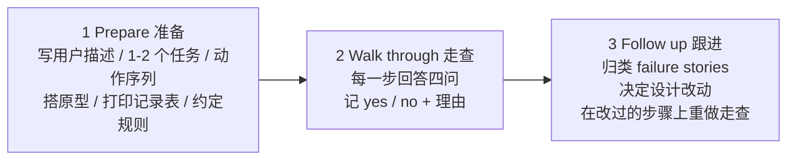
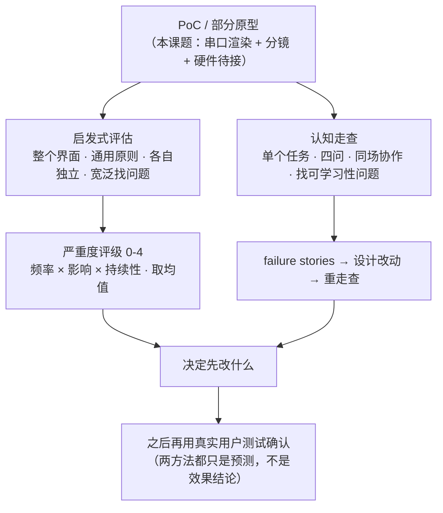

# POC 评估方法 · POC Evaluation Methods（Cognitive Walkthrough + Nielsen's Heuristics）

> 本笔记把 Week 12 讲义（*POC evaluation methods: Cognitive Walkthrough, Nielsen's heuristics*，CMAA 6019，Instructor: Mirjana Pripa，2026-11-17）整理为**纯文字概念梳理**，幻灯片页码标在每节标题后（如 `p.442`），便于回原文核对。
> This note digests the Week 12 lecture on **Cognitive Walkthrough** and **Nielsen's heuristics** into text-only concept notes; slide numbers are given per section for cross-checking the originals.
>
> 来源批次共 29 张照片：其中 4 张为完全重复（`120=482`、`121=478`、`122=473`、`123=483`），另有 2 张为同一页记录表的不同拍摄（`475` / `477`）；去重后约 25 页，覆盖讲义 pp.442–485。**没有上传任何截图**，图片仅本地读取后转录。

> **相关笔记 Companion**：[`concepts.md`](./concepts.md)（研究设计分组：其中的"专家评审 Expert review / 技术评估"正是这两方法的上位类别）· [`research-design.md`](./research-design.md) · [`README.md`](./README.md)

---

## 1. 两套方法总览 · Two methods at a glance

两者都是**专家型、无需真实用户**的早期评估方法（PoC evaluation methods），但定位不同（讲义 p.485）：

| 维度 Dimension | 启发式评估 Heuristic evaluation | 认知走查 Cognitive walkthrough |
|---|---|---|
| 范围 Scope | **整个界面** The whole interface | **单个任务、逐步** One task, step by step |
| 判断依据 Judged against | **通用可用性原则**（Nielsen 十条）General usability principles | **面向首次使用者的四个问题** Four questions about a first-time user |
| 最擅长发现 Best at finding | 大范围问题：一致性、反馈、错误、杂乱 Broad problems: consistency, feedback, errors, clutter | **特定路径上的可学习性问题** Learnability problems on a specific path |
| 评估者怎么工作 Evaluators work | **各自独立，之后汇总** Alone, then merge | **一起，在同一场 session 中** Together, in one session |

**怎么选（讲义原话提炼）**
- 认知走查 p.443：**Use it when** — 用户将**未经培训**使用系统；你已有 storyboard / 原型 / 部分系统，但**太早或太贵、不能找参与者**；你想检查**每一步的提示、标签、反馈是否可理解**。**It does not tell you** — 用户会多快、多满意；任务本身是否选对；真实用户会怎么做（其发现是**预测**，之后要用可用性测试确认）。
- 启发式评估 p.476：**Use it when** — 有评估者可试用/查看的原型、mockup 或部分系统；想在用户测试前**低成本去掉明显问题**；需要对**整个界面**做宽泛检查，而不只是一个任务。

---

## 2. 认知走查 · Cognitive Walkthrough

### 2.1 是什么 · What is it（p.442）

- **专家型评估方法**：评估者**一次一个动作**地走查一个任务，问"一个**首次使用者**能否想出该做什么"。
  An expert-based evaluation method: evaluators go through a task **one action at a time** and ask whether a **first-time user** could work out what to do.
- 三个关键词：
  - **Learnability 可学习性**：评估"人能否靠探索、不经培训就用起来"。
  - **No participants 无需参与者**：评估者想象一个具体用户，就每一步讲述"这个用户会怎么想、怎么做"的可信故事。
  - **Likely problems 可能的问题**：某一步若讲不出**可信的成功故事**，方法就找到了一个可能的问题。
- 文献：Polson et al. (1992)；Wharton et al. (1994)。

### 2.2 开始前需要什么 · What you need before you start（p.444，任务细节 p.446）

四项输入 **INPUT 1–4**：

| 输入 | 含义 Meaning |
|---|---|
| **INPUT 1 · User description 用户描述** | 用户是谁，以及他们对任务和技术**已经知道什么**。Who the users are and what they already know. |
| **INPUT 2 · Tasks 任务** | **1–3 个代表性任务**，每个都以**用户自己的话**表述为"用户的目标"。One to three representative tasks, each as the user's goal in the user's words. |
| **INPUT 3 · Action sequence 动作序列** | 每个任务的**正确步骤**：每个用户动作 + 系统如何响应。The correct steps: every user action and how the system responds. |
| **INPUT 4 · Representation 表征物** | 能展示每一步的东西：storyboard、低保真原型、Wizard of Oz 装置，或你的 PoC。 |

任务措辞的两条硬要求（p.446）：**只说用户想做什么，不说他会怎么做**；**非常具体**。时间预算：**每个任务 60–90 分钟**（Wharton et al., 1994）。

### 2.3 角色 · Roles（p.445）

| 角色 | 职责 |
|---|---|
| **Facilitator 引导者** | 朗读取用户描述与任务目标，逐步呈现，按顺序问四个问题，执行规则并计时。 |
| **Recorder 记录者** | 把每个答案及其理由、failure story 写进记录表，并另列一张设计想法清单。 |
| **Prototype operator 原型操作员**（可选，引导者可兼任） | 在每一步展示/操作原型，回答关于"它实际怎么表现"的事实性问题。 |
| **Evaluators 评估者（分析者）** | 来自另一团队；以**首次使用者**视角，对每一步回答四个问题并给理由。 |

> 铁律：**引导者与记录者必须分开**；被评估部分的**设计者不应担任引导者**。Keep the facilitator and the recorder separate; the designer of the part being evaluated should not facilitate.

### 2.4 流程 · The procedure（p.446）

1. **Prepare 准备**：写用户描述、1–2 个任务、每个任务的所有动作（用户视角）+ 系统对应响应；搭好原型；打印记录表并约定基本规则。
2. **Walk through 走查**：每一步回答四个问题，记录 yes/no 并说明理由。
3. **Follow up 跟进**：把 failure stories 归类，决定设计改动，在改过的步骤上**再走查一次**。

### 2.5 四个问题 · The four questions（p.455）

每一步都问，始终从**首次使用者视角**出发（Wharton et al., 1994）：

| 问题 | 问的是什么 | 步骤在哪里失败 Where steps fail |
|---|---|---|
| **Q1 · Goal 目标** | 用户会想达成"这一步所达成的事"吗？Will the user be trying to achieve what this step achieves? | 用户从**任务**和系统**已展示的内容**形成目标，而不是从设计者的计划。仅因系统需要才存在的步骤（确认、保存、切换模式）常在此失败。 |
| **Q2 · Notice 注意** | 用户会注意到"正确动作是可用的"吗？Will the user notice that the correct action is available? | 控件藏在菜单里、在屏幕外、只短暂出现，或样式看起来**不像可交互**。 |
| **Q3 · Connect 连接** | 用户会把正确动作与"他想做的事"联系起来吗？Will the user connect the correct action with what they are trying to do? | 熟悉的惯例有帮助；另一个可用动作可能看起来**更像**正确答案。 |
| **Q4 · Feedback 反馈** | 行动后，用户能看到"自己正在取得进展"吗？After acting, will the user see that they are making progress? | 没有"动作已被登记"的反馈，用户会**重复动作、撤销或放弃**。 |

### 2.6 写动作序列 · Writing an action sequence（p.450–451）

- 序列中**每个动作写两行**：一行"用户做什么"，一行"系统如何响应"。For each action, one line for what the user does and one line for how the system responds.
- **拆分到每一步都只有一个用户动作 + 一个系统响应**为止。Split until each step has one user action and one system response.
- 讲义例子：用户看到上传按钮并点击 → 系统显示旋转圆圈与"your video is uploading"。
- **Cognitive Walkthrough Recording Sheet 记录表**的列：`Step` / `Correct action (user action and system response)` / `Q1 Goal` / `Q2 Notice` / `Q3 Connect` / `Q4 Feedback` / `Failure story` / `Design change`；表头填 `User` / `Task goal` / `Analysts and date`。

### 2.7 当 PoC 不完整时 · When the PoC is incomplete（p.453）

| 策略 | 做法 |
|---|---|
| **Mix representations 混合表征** | 已做通的步骤用 PoC，其余用 storyboard 分镜、mockup 或一小段视频。 |
| **Operator plays the system 操作员扮演系统** | 原型操作员**说出系统的台词、触发屏幕或灯光、或手动移动设备**（Wizard of Oz 式）。 |
| **Choose the task 选任务** | 挑那些**步骤大多已实现**的任务，但仍从**用户目标**出发来表述。 |

---

## 3. Nielsen 十条可用性启发式 · Nielsen's Ten Heuristics

### 3.1 清单 · The ten（p.467，Nielsen 1994a）

1. Visibility of system status 系统状态可见性
2. Match between system and the real world 系统与现实世界的匹配
3. User control and freedom 用户控制与自由
4. Consistency and standards 一致性与标准
5. Error prevention 错误预防
6. Recognition rather than recall 识别胜过回忆
7. Flexibility and efficiency of use 灵活性与使用效率
8. Aesthetic and minimalist design 审美与极简设计
9. Help users recognize, diagnose, and recover from errors 帮助用户识别、诊断、从错误中恢复
10. Help and documentation 帮助与文档

> ⚠️ 本批照片含**第 1–7 条与第 10 条的专页**；第 8、9 条只在 p.467 的十项总览里出现，未单独拍到，故下表不替它们编造 "Ask / violation"。

### 3.2 逐条要点 · What it means / Ask / A violation

| # | What it means 含义 | Ask 自问 | A violation 反例 | 页 |
|---|---|---|---|---|
| **1** | 系统通过**及时反馈**让用户随时知道正在发生什么。 | 用户能一直说出系统在做什么、自己的动作是否生效吗？ | 按下 Submit 后屏幕毫无变化，于是用户又按一次。 | 468 |
| **2** | 系统用**用户的语言**说话：他们熟悉的词、概念与惯例。 | 新手不看团队术语也能懂每个标签和消息吗？ | 错误写 "HTTP 500"，而不是"我们没能保存文件，请重试"。 | 469 |
| **3** | 用户会犯错，需要有**明确标记的出路**（取消、撤销）。 | 用户能轻松离开、取消或撤销每个动作吗？ | 长时间上传没有取消按钮；删掉的东西无法恢复。 | 470 |
| **4** | 用户不必纠结不同词/动作是否同义；遵循平台惯例。 | 同一件事是否始终同样命名、摆放、 styling？ | 同一操作在一屏叫 "Save"、另一屏叫 "Apply"。 | 471 |
| **5** | 好的错误消息不如**从设计上阻止错误发生**。 | 用户可能在哪里出错，设计能否预防？ | "Delete all" 紧挨 "Download"，且没有确认步骤。 | 472 |
| **6** | 让选项和信息**可见**，用户无需记住它们。 | 用户是否需要记住一屏的东西才能用在另一屏？ | 用户得从一页抄下验证码，再凭记忆输入到下一页。 | 473 |
| **7** | 新手看不见的**快捷方式**能让熟练用户更快。 | 高频用户能否更快？人们能否按自己的工作方式调整界面？ | 无法重复上一个动作，也没有键盘快捷键。 | 474 |
| **10** | 理想情况系统无需解释，但**帮助要易找、且聚焦用户任务**。 | 新手卡住时能找到"怎么做这个任务"吗？ | 高级设置没有任何说明，帮助页也没提到它们。 | 477 |

### 3.3 怎么做 · How it is done（p.478）

四项输入：

| 输入 | 内容 |
|---|---|
| **INPUT 1 · Heuristic set** | Nielsen 十条，每条附一行解释，发给每位评估者。 |
| **INPUT 2 · Evaluators** | **3–5 名**懂 HCI、**且未参与设计**该系统的人。 |
| **INPUT 3 · Briefing** | 一页纸：目标用户、使用情境、**2–3 个典型任务**。 |
| **INPUT 4 · Representation** | 每位评估者可**独自检查**的东西：原型、mockup 或部分系统。 |

时间预算：**每位评估者 1–2 小时，外加一场 1 小时的小组会**。

### 3.4 严重度评级 · Rating severity（p.483，Nielsen 1994b）

| Rating | Meaning 含义 | Action 处理 |
|---|---|---|
| **0** | 不是可用性问题 Not a usability problem | 丢弃，并记下分歧 |
| **1** | 外观问题 Cosmetic problem | 有时间才修 |
| **2** | 次要可用性问题 Minor usability problem | 低优先级 |
| **3** | 严重可用性问题 Major usability problem | 高优先级，重要，要修 |
| **4** | 可用性灾难 Usability catastrophe | 用户看到之前必须修 |

从三个因素判断：**frequency 频率**（多少用户遇到）、**impact 影响**（多难克服）、**persistence 持续性**（一次还是每次）。每位评估者**先独立评级**，汇总后取**至少三人**的均值。

---

## 4. 方法之间的关系 · How the pieces fit

