# 研究设计与规划 · Research Design & Planning

> **来源 Source**：CMAA6019 *HCI for Embodied AI*，Week 10「Ethics / Study Design」讲义截图 19 张（有效 17 张），已重命名存入 [`note/assets/`](./assets/)（`rd-01` … `rd-17`）。
> Lecture screenshots from CMAA6019 *HCI for Embodied AI*, Week 10 "Ethics / Study Design" (19 shots, 17 usable), renamed into [`note/assets/`](./assets/) as `rd-01` … `rd-17`.
>
> **配套 Companion**：[`concepts.md`](./concepts.md) 讲"方法工具箱"（发明型研究三部分 / 研究设计分组 / 数据收集）；本笔记讲**怎么把一项研究设计与规划搭起来**——范式、层级、问题、决策、伦理、对齐。
> `concepts.md` covers the "methods toolbox" (three parts of inventive research / study-design groups / data collection); this note covers **how to construct and plan a study** — paradigm, levels, questions, decisions, ethics, alignment.
>
> **性质 Nature**：概念梳理，不是研究正文。凡涉及本课题的取舍，一律标 `📝 TODO（手写）`，由维护者定稿。
> A concept digest, not research prose. Every project-specific choice is marked `📝 TODO（手写）` for the maintainer to settle.

**怎么读 How to read**：先看 [§0 一页速查](#0-一页速查--one-page-cheat-sheet)；写 proposal 时按 [§5 十二项决策](#5-规划十二项决策--twelve-planning-decisions) 逐项过；改 RQ 措辞前先看 [§13 常见错配](#13-让设计与问题对齐--aligning-design-with-the-question)；与自己课题的连接在 [§14](#14-与本课题的对应--mapping-to-our-project)。

---

## 0. 一页速查 · One-page cheat sheet

| 你的 RQ 在问什么 · What your RQ asks | 设计 · Design | 数据收集 · Data collection | 数据分析 · Analysis |
|---|---|---|---|
| 人们做什么、需要什么、看重什么 What people do, need or value | 访谈研究、观察、问卷研究、需求引出、协同设计 Interview study, observation, survey, elicitation, co-design | 半结构化访谈、观察、问卷、日记研究 Semi-structured interview, observation, questionnaire, diary | 主题分析、内容分析、描述统计 Thematic / content analysis, descriptive statistics |
| 这个行为对人们意味着什么 What the behaviour means to people | 形成性研究 Formative study | 影像记录、刺激性回忆访谈、行为编码 Video recording, stimulated recall, behavioural coding | 反身主题分析 Reflexive thematic analysis |
| X 相比 Z 是否改变了 Y Does X vs Z change Y | 带基线的受控实验 Controlled experiment with baseline | 交互日志、验证量表、性能指标 Interaction logging, validated scales, performance metrics | t 检验、ANOVA、非参数检验、混合效应模型、效应量 t-test, ANOVA, non-parametric, mixed-effects, effect sizes |
| 新增组件是否改进了模型 Does the added component improve the model | 资源匹配基线的消融实验 Ablation study with resource-matched baselines | 专家标注、留出数据 Expert annotation, held-out data | 对比性能分析、误差分析 Comparative performance, error analysis |

**三条纪律 Three rules of thumb**

1. 措辞决定设计：用了"更好 / 更低负担 / 更可能"，就必须有对照条件。 *Wording commits you to a design: say "better / lower burden / more likely" and you owe a comparison condition.*
2. 主张时间跨度，就要有跨时间的数据：一次会话证明不了"长期使用"。 *Claim a time span and you need data across time: one session cannot support "long-term use".*
3. 先定分析、再收数据：分析计划跑在数据前面。 *Fix the analysis before collecting: the analysis plan precedes the data.*

---

## 1. 研究范式 · Research Paradigms

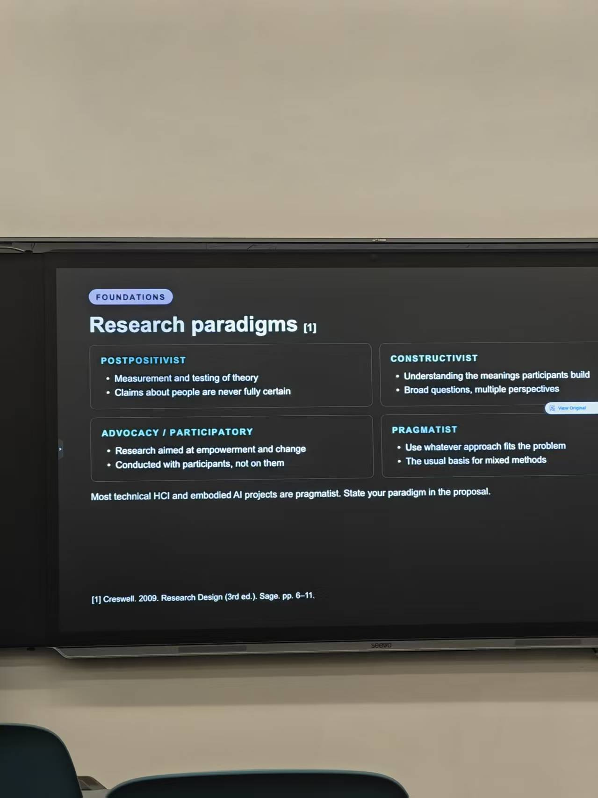

| 范式 · Paradigm | 它认为什么算知识 · What counts as knowledge | 典型做法 · Typical move |
|---|---|---|
| **后实证 Postpositivist** | 测量与检验理论；关于人的结论永远无法完全确定。 Measurement and testing of theory; claims about people are never fully certain. | 提出预测，用受控条件检验。 State a prediction, test it under controlled conditions. |
| **建构 Constructivist** | 理解参与者自己建构的意义；问题宽、视角多。 Understanding the meanings participants build; broad questions, multiple perspectives. | 深访、观察，产出主题。 In-depth interviews and observation, yielding themes. |
| **倡导 / 参与 Advocacy / participatory** | 研究指向赋权与改变；与参与者一起做，而不是"对"他们做。 Research aimed at empowerment and change; conducted *with* participants, not *on* them. | 协同设计、行动研究。 Co-design, action research. |
| **实用主义 Pragmatist** | 哪种方法能解决问题就用哪种；混合方法最常用的底座。 Use whatever approach fits the problem; the usual basis for mixed methods. | 按问题选方法，不预设立场。 Pick methods to fit the problem. |

> 讲义原话：多数技术型 HCI 与具身 AI 项目是**实用主义**的——要在 proposal 里把自己的范式写明。
> The lecture's own line: most technical HCI and embodied-AI projects are **pragmatist** — state your paradigm in the proposal.

📝 TODO（手写）：本课题声明哪种范式？若走"技术 HCI + 具身 AI"，实用主义是默认答案，但需在 `docs/methods.md` §1 写清理由。

---

## 2. 四个层级：范式 → 方法学 → 设计 → 方法 · Paradigm → Methodology → Design → Method

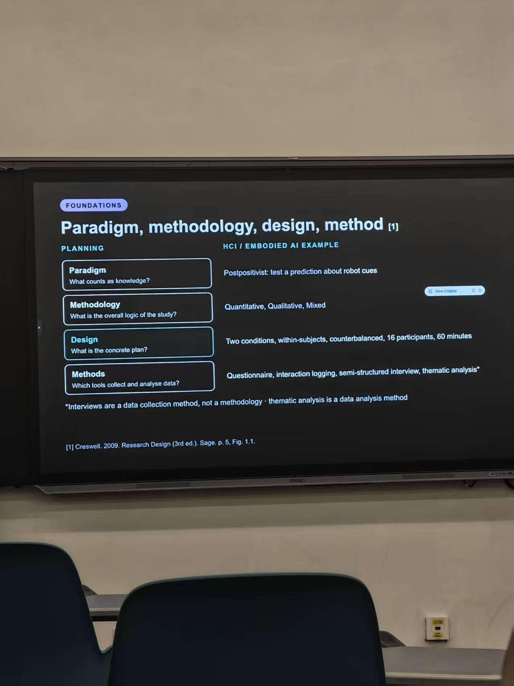

| 层级 · Level | 要回答的规划问题 · Planning question | 讲义给的 HCI / 具身 AI 例子 · Lecture example |
|---|---|---|
| 范式 Paradigm | 什么算知识？ What counts as knowledge? | 后实证：检验一个关于机器人提示的预测。 Postpositivist: test a prediction about robot cues. |
| 方法学 Methodology | 研究的总体逻辑是什么？ What is the overall logic? | 定量 / 定性 / 混合。 Quantitative, qualitative, mixed. |
| 设计 Design | 具体方案是什么？ What is the concrete plan? | 两个条件、被试内、顺序平衡、16 人、60 分钟。 Two conditions, within-subjects, counterbalanced, 16 participants, 60 minutes. |
| 方法 Method | 用什么工具收集与分析？ Which tools collect and analyse? | 问卷、交互日志、半结构化访谈、主题分析。 Questionnaire, interaction logging, semi-structured interview, thematic analysis. |

> ⚠️ 讲义特别纠正的两个常见误用：**访谈是数据收集方法，不是方法学**；**主题分析是数据分析方法，不是评估系统的方式**。
> Two corrections the lecture makes explicit: **interviews are a data-collection method, not a methodology**; **thematic analysis is a data-analysis method, not a way to evaluate a system**.

---

## 3. 从题目到研究问题 · From Topic to Research Question

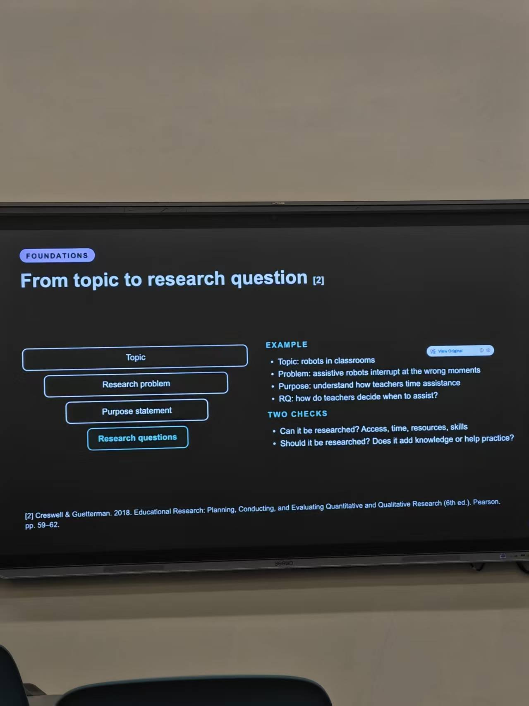

研究问题不是一拍脑袋想出来的，它是**从宽到窄逐层收口**的产物。
A research question is not improvised; it is the narrow end of a funnel.

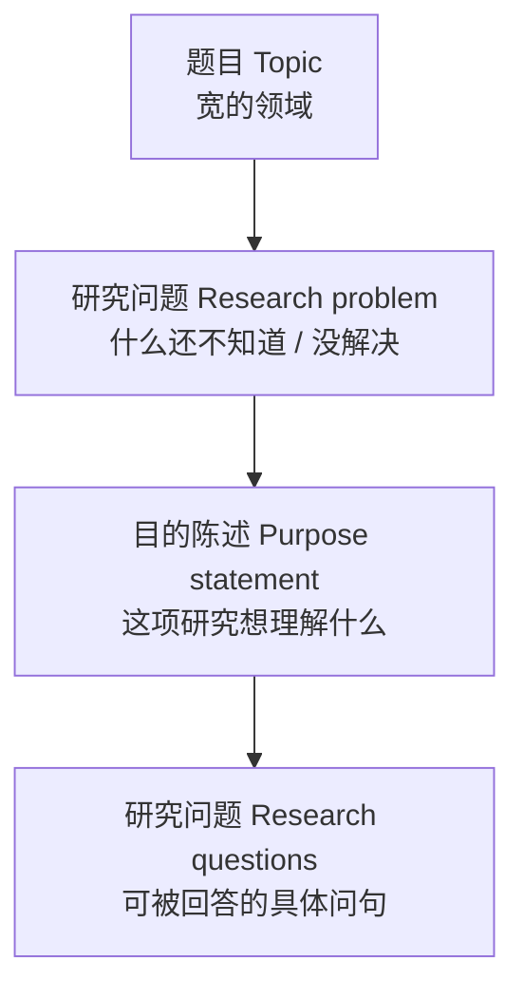

**讲义例子 Example**

| 层级 | 内容 |
|---|---|
| 题目 Topic | 课堂里的机器人。 Robots in classrooms. |
| 研究问题 Research problem | 辅助机器人总在错误的时机打断。 Assistive robots interrupt at the wrong moments. |
| 目的陈述 Purpose statement | 理解教师如何把握辅助时机。 Understand how teachers time assistance. |
| 研究问题 Research question | 教师如何决定何时该介入？ How do teachers decide when to assist? |

**两道自检 Two checks**

- **能不能做 Can it be researched?** 访问权限、时间、资源、技能是否具备。 Access, time, resources and skills are available.
- **该不该做 Should it be researched?** 它是否增加知识或改善实践。 Does it add knowledge or help practice?

📝 TODO（手写）：把我们现在的题目按这四层各写一句，检查"目的陈述"是否真的落在"理解/支持"而不是"造一个系统"。

---

## 4. 研究问题 vs 假设 · Research Question vs Hypothesis

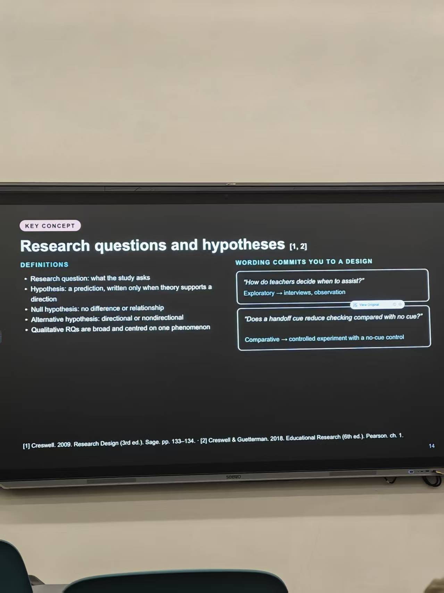

| 概念 · Term | 定义 · Definition |
|---|---|
| 研究问题 Research question | 这项研究要问什么。 What the study asks. |
| 假设 Hypothesis | 一个**预测**；只有理论支持某个方向时才写。 A prediction, written **only when theory supports a direction**. |
| 零假设 Null hypothesis | 没有差异、没有关系。 No difference or relationship. |
| 备择假设 Alternative hypothesis | 有方向性或无方向性的差异。 A directional or non-directional difference. |
| 定性 RQ Qualitative RQ | 宽，聚焦单一现象。 Broad, centred on one phenomenon. |

**关键：措辞会把你自己锁进某种设计。** *Wording commits you to a design.*

| 措辞 · Wording | 隐含设计 · Implied design |
|---|---|
| "教师如何决定何时介入？" "How do teachers decide when to assist?" | 探索性 → 访谈、观察。 Exploratory → interviews, observation. |
| "相比无提示，交接提示能否减少反复确认？" "Does a handoff cue reduce checking compared with no cue?" | 比较性 → 带"无提示对照"的受控实验。 Comparative → controlled experiment with a no-cue control. |

📝 TODO（手写）：逐条检查我们的 RQ 里有没有"更好/更低负担/更愿意"这类比较词。若有，要么补对照条件，要么改成描述性问法。

---

## 5. 规划十二项决策 · Twelve Planning Decisions

讲义把"动手之前要想清楚的事"排成 12 项。左列是决策，右列是**你应当产出的东西**。
The lecture lays out twelve decisions to settle before data collection; the right column is the artifact each should produce.

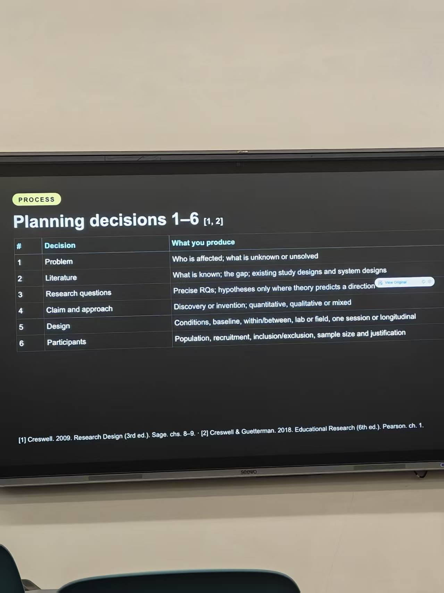

### 5.1 决策 1–6 · Decisions 1–6

| # | 决策 · Decision | 你产出什么 · What you produce |
|---|---|---|
| 1 | **问题 Problem** | 谁受影响；什么还不知道或没被解决。 Who is affected; what is unknown or unsolved. |
| 2 | **文献 Literature** | 已知什么；缺口在哪；已有的研究设计与系统设计。 What is known; the gap; existing study designs and system designs. |
| 3 | **研究问题 Research questions** | 精确的 RQ；只在理论预测方向时才写假设。 Precise RQs; hypotheses only where theory predicts a direction. |
| 4 | **主张与取向 Claim and approach** | 发现还是发明；定量、定性还是混合。 Discovery or invention; quantitative, qualitative or mixed. |
| 5 | **设计 Design** | 条件、基线、被试内/间、实验室/田野、单次/纵向。 Conditions, baseline, within/between, lab or field, one session or longitudinal. |
| 6 | **参与者 Participants** | 总体、招募、纳入/排除、样本量与理由。 Population, recruitment, inclusion/exclusion, sample size and justification. |

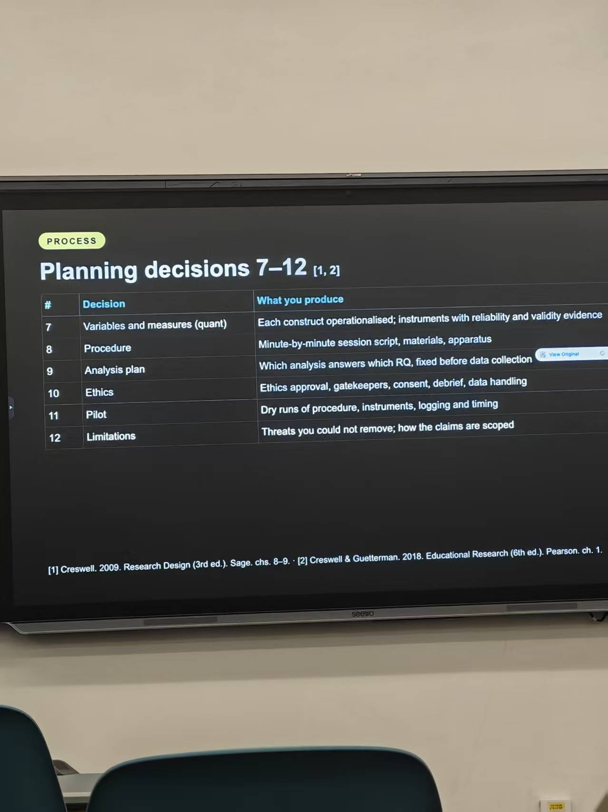

### 5.2 决策 7–12 · Decisions 7–12

| # | 决策 · Decision | 你产出什么 · What you produce |
|---|---|---|
| 7 | **变量与测量（定量）Variables and measures** | 每个构念都被操作化；工具有信度与效度证据。 Each construct operationalised; instruments with reliability and validity evidence. |
| 8 | **流程 Procedure** | 逐分钟会话脚本、材料、器材。 Minute-by-minute session script, materials, apparatus. |
| 9 | **分析计划 Analysis plan** | 哪个分析回答哪个 RQ，**在收数据之前定死**。 Which analysis answers which RQ, fixed before data collection. |
| 10 | **伦理 Ethics** | 伦理审批、守门人、知情同意、事后说明、数据处理。 Ethics approval, gatekeepers, consent, debrief, data handling. |
| 11 | **预试 Pilot** | 对流程、工具、日志与计时的干跑。 Dry runs of procedure, instruments, logging and timing. |
| 12 | **局限 Limitations** | 你无法消除的威胁；主张的边界如何划定。 Threats you could not remove; how claims are scoped. |

> 这一张表可以直接当 proposal 的自检清单用：**任何一格空着，都是后面会被审稿人问的地方。**
> Use this table as a proposal checklist: **any empty cell is where reviewers will push later.**

---

## 6. 过程的两条规则 · Two Rules for the Process

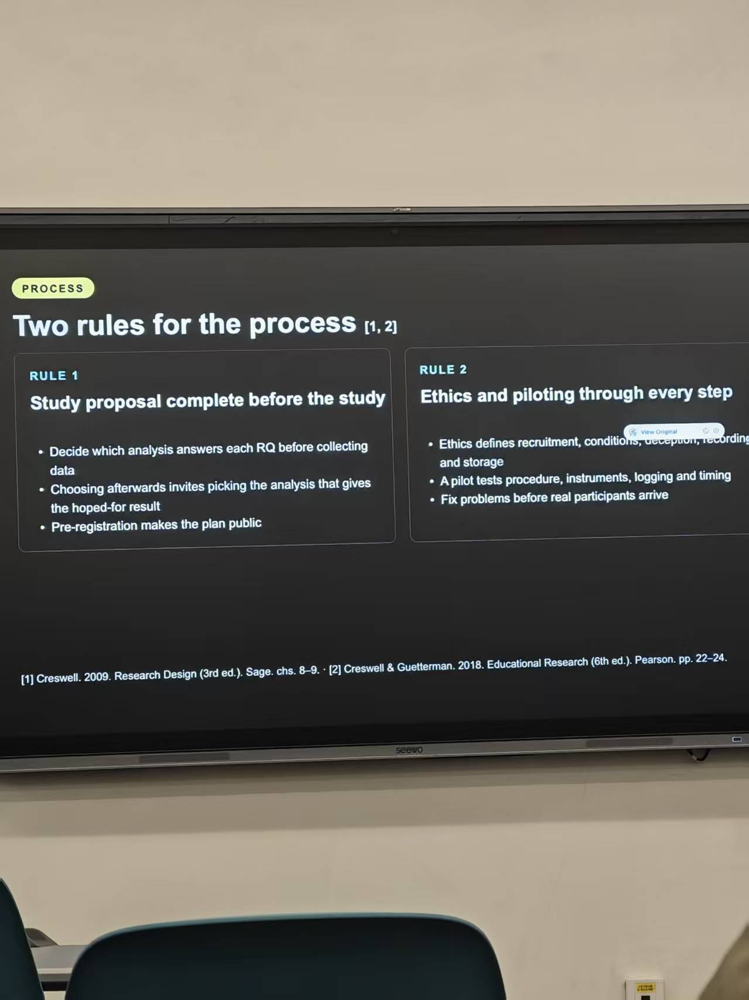

| 规则 · Rule | 内容 · What it says |
|---|---|
| **规则 1：研究方案先于研究完成** Rule 1: Study proposal complete before the study | 收数据之前决定"哪个分析回答哪个 RQ"；事后选分析等于挑一个能得到期望结果的做法；**预注册**让计划公开。 Decide which analysis answers each RQ *before* collecting; choosing afterwards invites picking the analysis that gives the hoped-for result; **pre-registration** makes the plan public. |
| **规则 2：伦理与预试贯穿每一步** Rule 2: Ethics and piloting through every step | 伦理定义了招募、条件、欺骗、录制与存储；预试检验流程、工具、日志与计时；在真参与者到来之前把问题修掉。 Ethics defines recruitment, conditions, deception, recording and storage; a pilot tests procedure, instruments, logging and timing; fix problems before real participants arrive. |

---

## 7. 定量、定性与混合 · Quantitative, Qualitative and Mixed

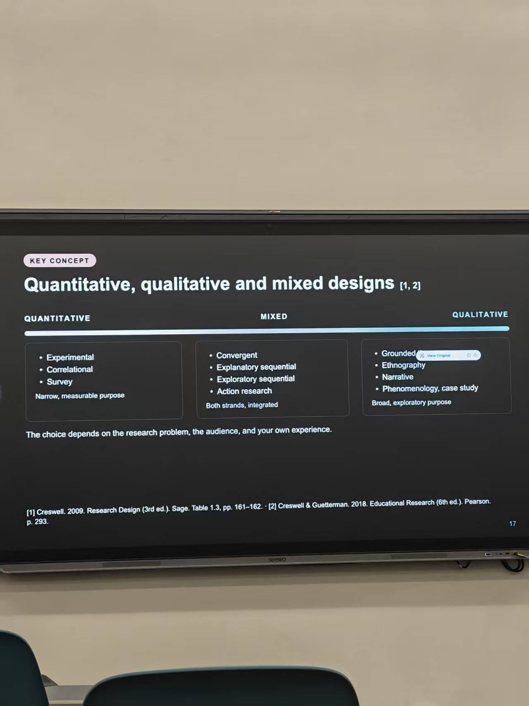

| 定量 Quantitative | 混合 Mixed | 定性 Qualitative |
|---|---|---|
| 实验 Experimental 相关 Correlational 问卷 Survey | 聚敛 Convergent 解释性顺序 Explanatory sequential 探索性顺序 Exploratory sequential 行动研究 Action research | 扎根理论 Grounded theory 民族志 Ethnography 叙事 Narrative 现象学 Phenomenology 案例研究 Case study |
| **窄、可测量** Narrow, measurable purpose | **两条线，且被整合** Both strands, integrated | **宽、探索性** Broad, exploratory purpose |

> 讲义强调：选哪种**取决于研究问题、读者，以及你自己的经验**——不是"哪个更高级"。
> The choice **depends on the research problem, the audience, and your own experience** — not on which is "more advanced".

---

## 8. 混合方法的三种整合结构 · Three Mixed-Methods Structures

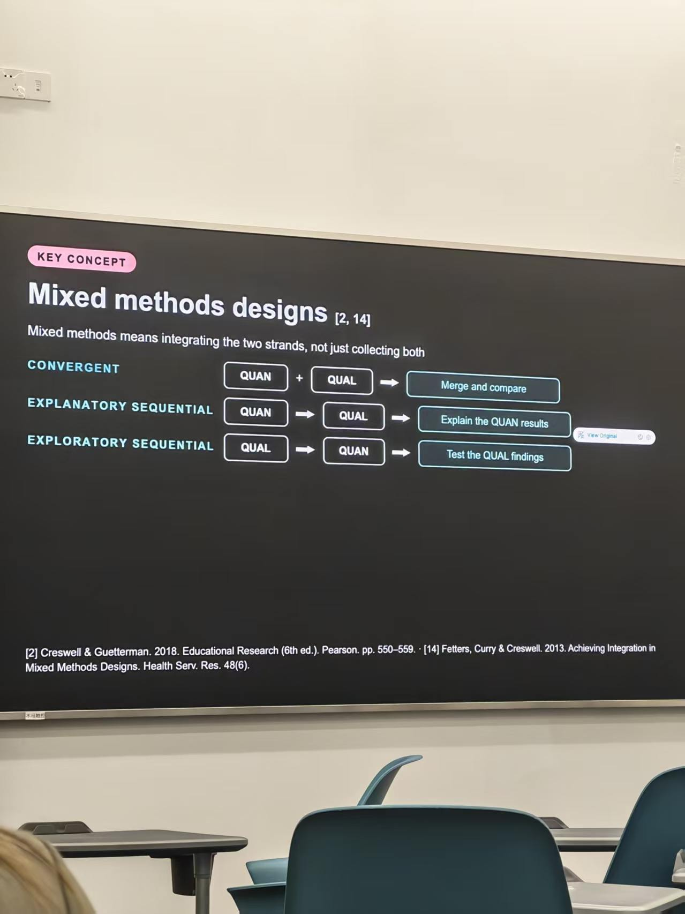

> 定义先行：**混合方法意味着把两条线整合起来，而不是"两种数据都收了"。**
> Definition first: **mixed methods means integrating the two strands, not merely collecting both.**

| 结构 · Structure | 顺序 · Order | 整合点 · Integration point |
|---|---|---|
| **聚敛 Convergent** | QUAN + QUAL（并行） | 合并与比较 → Merge and compare |
| **解释性顺序 Explanatory sequential** | QUAN → QUAL | 用定性**解释**定量结果 → Explain the QUAN results |
| **探索性顺序 Exploratory sequential** | QUAL → QUAN | 用定量**检验**定性发现 → Test the QUAL findings |

📝 TODO（手写）：本课题更像"探索性顺序"——先访谈摸清患者在记录/归因上的障碍，再用问卷或日志检验。确认是否采用，并在 methods 里写明"整合点"落在哪一步。

---

## 9. 被试内 vs 被试间 · Within- vs Between-Subjects

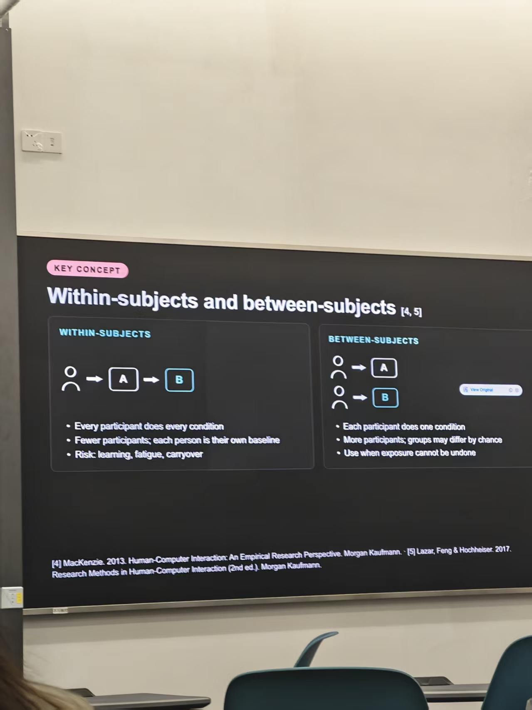

| | **被试内 Within-subjects** | **被试间 Between-subjects** |
|---|---|---|
| 安排 · Arrangement | 每个参与者做**所有**条件（A → B）。 Every participant does every condition. | 每个参与者只做**一个**条件。 Each participant does one condition. |
| 人数 · Participants | 更少；**每个人是自己的基线**。 Fewer; each person is their own baseline. | 更多；组间可能因偶然产生差异。 More; groups may differ by chance. |
| 风险 · Risk | 学习、疲劳、**顺序/残留效应**。 Learning, fatigue, carryover. | 若不随机分配，组间不可比。 Groups may not be comparable without randomisation. |
| 何时用 · When | 条件可重复、负担低。 | **暴露不可撤销**时（如一次性的欺骗、不可逆培训）。 When exposure cannot be undone. |

> 配套做法：被试内要**顺序平衡（counterbalancing）**；被试间要**随机分配**。两者都属于"质量做法"，不属于"方法"本身。
> Companions: counterbalance order for within-subjects, randomise assignment for between-subjects. Both are *quality practices*, not methods.

---

## 10. 基线与控制条件 · Baselines and Control Conditions

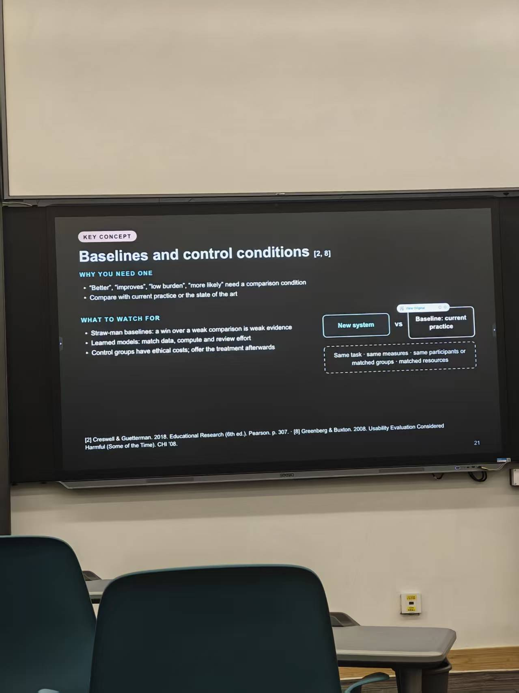

**为什么必须有 Why you need one**

- "更好 / 有改善 / 更低负担 / 更可能"这类主张，**必须有比较条件**。 Claims like "better / improves / lower burden / more likely" **need a comparison condition**.
- 对照应当是**当前实践**或**领域最优**，而不是随便找个东西。 Compare against **current practice** or the state of the art, not just anything.

**要提防什么 What to watch for**

| 陷阱 · Pitfall | 说明 · Why it matters |
|---|---|
| **稻草人基线 Straw-man baseline** | 赢了很弱的对手，是很弱的证据。 A win over a weak comparison is weak evidence. |
| **学习模型的不公平比较 Learned models** | 要匹配数据量、算力与人工审核投入。 Match data, compute and review effort. |
| **对照组的伦理成本 Control groups** | 对照组成员被剥夺了可能的收益；研究结束后应提供处理。 Controls are deprived of a possible benefit; offer the treatment afterwards. |
| **资源不匹配 Resource mismatch** | 新系统多花了人力/时间，差异可能来自资源而非设计。 Extra human/time cost may explain the difference. |

> 讲义图示的一句话：**同样的任务、同样的测量、同样的参与者（或匹配组）、匹配的资源。**
> The slide's caption: **same task · same measures · same participants (or matched groups) · matched resources.**

---

## 11. HCI 里的样本量 · Sample Sizes in HCI

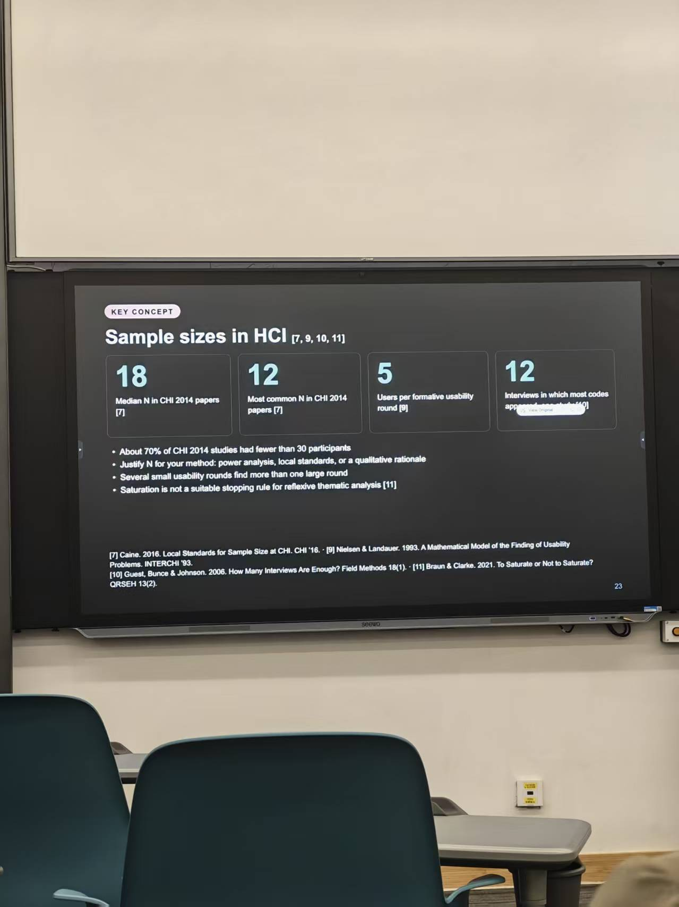

| 数字 · Number | 含义 · Meaning |
|---|---|
| **18** | CHI 2014 论文的**中位样本量**。 Median N in CHI 2014 papers. |
| **12** | CHI 2014 论文**最常见的样本量**。 Most common N in CHI 2014 papers. |
| **5** | 形成性可用性**每一轮**的用户数。 Users per formative usability round. |
| **12** | 多数编码都出现时的访谈数。 Interviews at which most codes appeared. |

**四条经验 Four rules**

1. 约 **70%** 的 CHI 2014 研究参与者少于 30 人。 About **70%** of CHI 2014 studies had fewer than 30 participants.
2. 为你的方法**论证 N**：功效分析、本领域惯例，或质性理由。 Justify N for your method: power analysis, local standards, or a qualitative rationale.
3. **多轮小规模**可用性测试，比一轮大规模更能发现问题。 Several small usability rounds find more than one large round.
4. **饱和（saturation）不适合**作为反身主题分析的停止规则。 Saturation is **not** a suitable stopping rule for reflexive thematic analysis.

> 注意第 4 条与"12 段访谈"的张力：12 是**观察到多数编码出现**的经验数，不是一个可以写进方法章的机械截止线。
> Note the tension with "12 interviews": 12 is an empirical observation about code coverage, not a mechanical cutoff to cite in your methods chapter.

📝 TODO（手写）：我们的访谈/测试计划里，N 的论证用的是哪一条？如果写"饱和"，按讲义要改成"信息力 / 反身判断"的表述。

---

## 12. 伦理 · Ethics

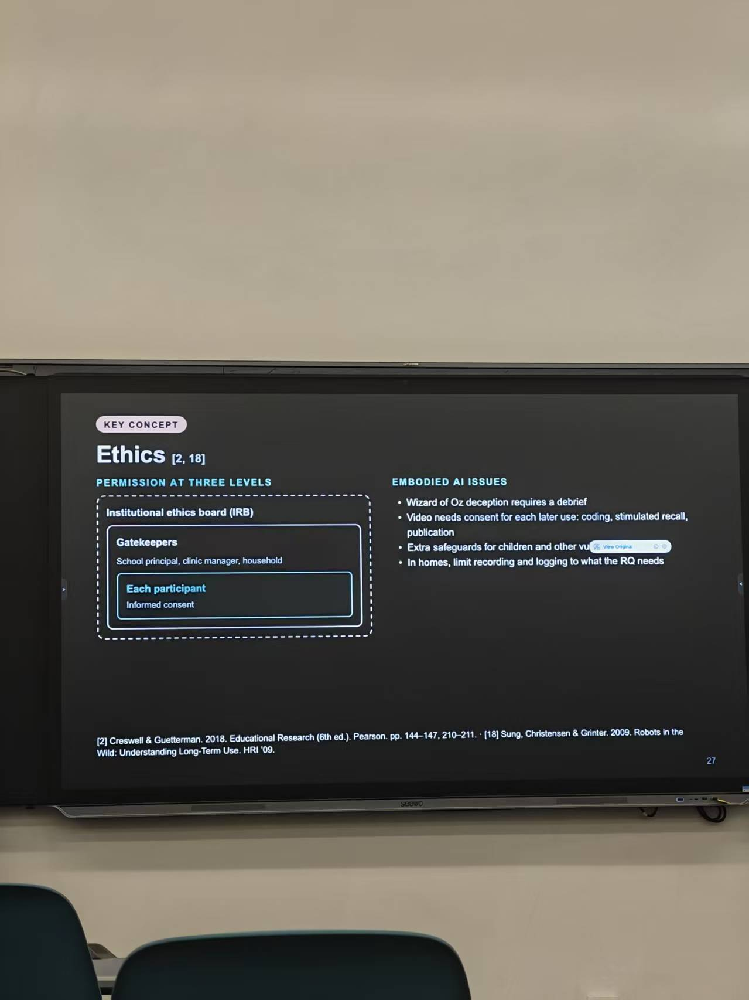

**三级许可 Permission at three levels**

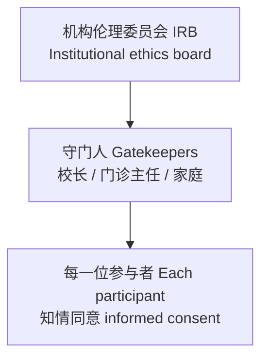

**具身 AI 的特有问题 Embodied-AI specific issues**

| 问题 · Issue | 处理 · Handling |
|---|---|
| **绿野仙踪式欺骗 Wizard-of-Oz deception** | 必须在结束后**事后说明（debrief）**。 Requires a debrief afterwards. |
| **影像的多重用途 Video reuse** | 每一种后续用途都要单独同意：编码、刺激性回忆、发表。 Consent for **each** later use: coding, stimulated recall, publication. |
| **儿童与其他弱势群体 Children / vulnerable groups** | 需要额外保护措施。 Extra safeguards. |
| **家庭场景的侵入 In-home sensing** | 录制与日志**只限于 RQ 所需**。 Limit recording and logging to what the RQ needs. |

📝 TODO（手写）：IRB 材料里，"影像后续用途"是否逐项写了？家用场景是否写了"最小化采集"条款？

---

## 13. 让设计与问题对齐 · Aligning Design with the Question

### 13.1 两种常见错配 · Two common mismatches

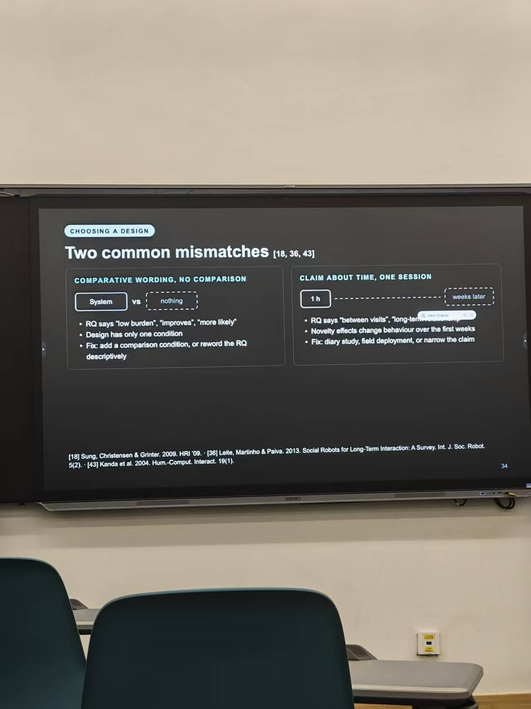

| 错配 · Mismatch | 症状 · Symptom | 修法 · Fix |
|---|---|---|
| **比较性措辞，却没有比较** Comparative wording, no comparison | RQ 说"低负担 / 有改善 / 更可能"，设计却**只有一个条件**。 The RQ says "low burden / improves / more likely" but the design has only one condition. | 补一个对照条件；或把 RQ 改成描述性。 Add a comparison condition, or reword the RQ descriptively. |
| **主张跨时间，却只做一次会话** Claim about time, one session | RQ 说"复诊间隔期 / 长期使用"，数据只有 1 小时。 The RQ says "between visits / long-term use" but the data span one hour. | 日记研究、田野部署；或收窄主张。 Diary study, field deployment, or narrow the claim. |

> 第二行对"低负担长期记录"这类课题尤其致命：**新奇效应**会在头几周改变行为，一次会话看到的很可能只是新奇，不是习惯。
> The second row is especially lethal for "low-burden long-term logging": **novelty effects** change behaviour over the first weeks, so a single session may measure novelty, not habit.

### 13.2 问题类型 → 设计（原表）· Question type → design

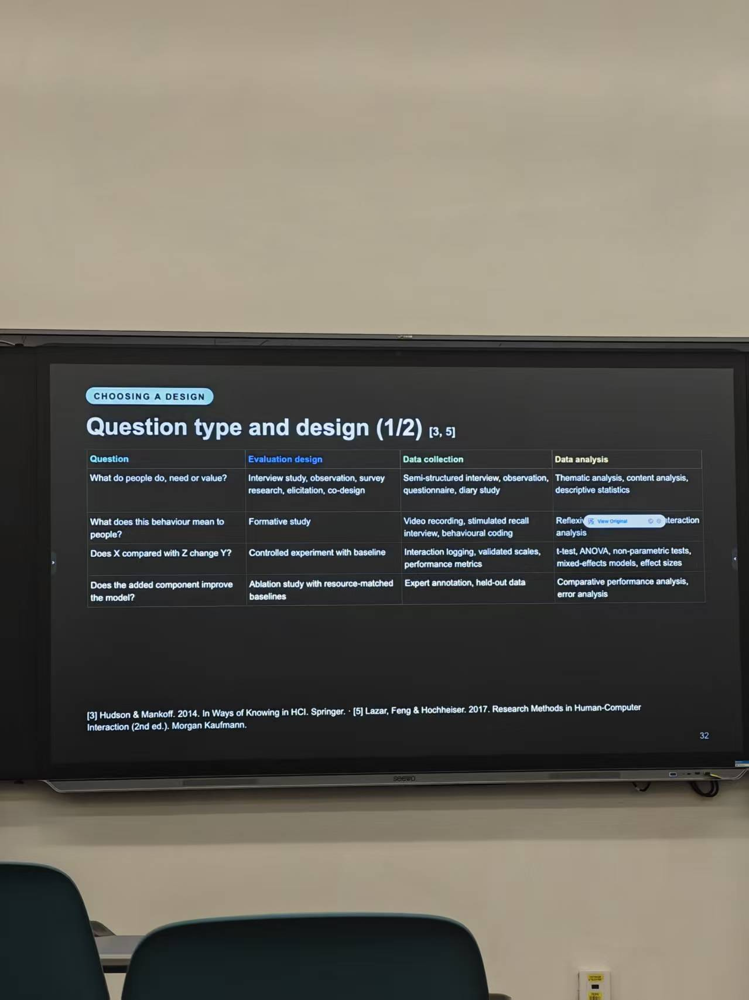

见 [§0 速查表](#0-一页速查--one-page-cheat-sheet)（同源，已折算成可读版）。
See the [§0 cheat sheet](#0-一页速查--one-page-cheat-sheet) — same content, rendered for reading.

### 13.3 方法按目的分类 · Methods by purpose

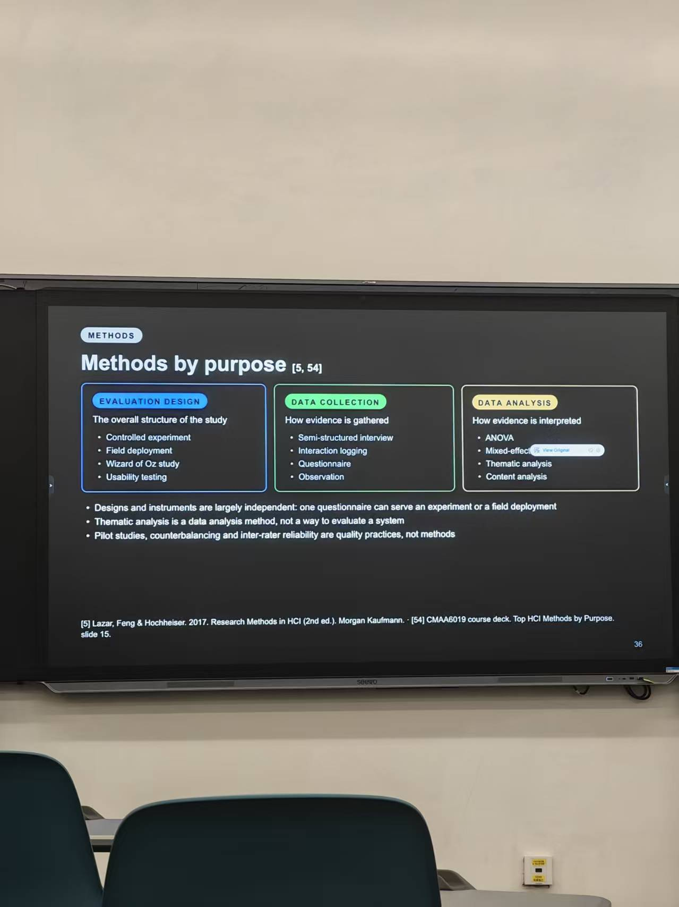

| 层 · Layer | 包含 · Contains |
|---|---|
| **评估设计 Evaluation design** 研究的整体结构 | 受控实验、田野部署、绿野仙踪研究、可用性测试。 Controlled experiment, field deployment, Wizard-of-Oz, usability testing. |
| **数据收集 Data collection** 证据怎么被采集 | 半结构化访谈、交互日志、问卷、观察。 Semi-structured interview, interaction logging, questionnaire, observation. |
| **数据分析 Data analysis** 证据怎么被解读 | ANOVA、混合效应模型、主题分析、内容分析。 ANOVA, mixed-effects model, thematic analysis, content analysis. |

> 三条澄清 Three clarifications：
> - 设计与工具**基本独立**：同一份问卷既可用于实验，也可用于田野部署。 *Designs and instruments are largely independent: one questionnaire can serve an experiment or a field deployment.*
> - 主题分析是**分析方法**，不是评估系统的方式。 *Thematic analysis is a data-analysis method, not a way to evaluate a system.*
> - 预试、顺序平衡、评分者间信度是**质量做法**，不是方法。 *Pilots, counterbalancing and inter-rater reliability are quality practices, not methods.*

---

## 14. 与本课题的对应 · Mapping to Our Project

> 只列"这张讲义逼我们必须回答的问题"，不替维护者做研究决策。
> This lists **questions the lecture forces us to answer**, not decisions made on the maintainer's behalf.

| 讲义决策点 · Lecture point | 本课题要回答什么 · What we must answer | 状态 · Status |
|---|---|---|
| 范式（§1） | 声明为实用主义？理由写在哪？ Declare pragmatism? Where is the rationale? | 📝 TODO（手写） |
| 方法学（§7–8） | 定性、定量，还是"探索性顺序"混合？整合点在哪一步？ Qual, quant, or exploratory-sequential mixed? Where is the integration point? | 📝 TODO（手写） |
| 设计（§9–10） | 被试内还是被试间？有无对照条件（如"常规记录方式"）？ Within or between? Is there a comparison condition (e.g. usual logging)? | 📝 TODO（手写） |
| 时间跨度（§13.1） | 若要主张"低负担、可持续"，是否必须做多周日记/部署？ To claim "low burden, sustainable", is a multi-week diary/deployment required? | 📝 TODO（手写） |
| 数据收集（§13.3） | 访谈 + 交互日志 + ESM + 日记，各覆盖哪个 RQ？ Which RQ does each of interview / logging / ESM / diary cover? | 见 [`concepts.md` §4](./concepts.md#4-数据收集方法--data-collection-methods) |
| 数据分析（§13.3） | 反身主题分析？编码策略与评分者一致性怎么处理？ Reflexive thematic analysis? How are coding and agreement handled? | 见 [`docs/methods.md`](../docs/methods.md) |
| 样本量（§11） | N 用哪条理由论证？避免写"饱和"。 Which justification for N? Avoid "saturation". | 📝 TODO（手写） |
| 伦理（§12） | 三级许可是否齐备？录屏/日志是否最小化？ All three permission levels? Is capture minimised? | 📝 TODO（手写，IRB） |
| 分析计划（§5.2 #9） | 是否在收数据前定死 RQ→分析映射？ Is the RQ→analysis map fixed before collection? | 📝 TODO（手写） |

**一句话 takeaway**：这套讲义真正逼问的是——**你的主张有多大，你的证据就必须有多宽**。主张"低负担、长期、更好"，就得有对照 + 跨时间 + 论证过的 N；只想说"我们做了一个可用的设计探针"，则截图＋小规模测试就够。
**One-line takeaway**: the deck really asks — **the breadth of your claim sets the breadth of evidence you owe.** Claim "low-burden, long-term, better" and you owe a comparison, a time span, and a justified N; claim only "a usable design probe", and screenshots plus a small test suffice.

---

## 15. 伦理争论站 · Debate Stations (A–D)

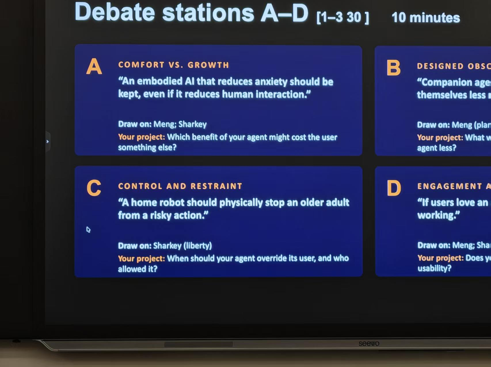

课堂用四个立场做 10 分钟站队辩论。它们不是结论，而是**设计取向的四个张力**——写讨论章时很好用。
Four positions for a 10-minute standing debate. They are not conclusions but **four tensions in design orientation** — useful for the discussion chapter.

| 站 · Station | 立场 · Position | 逼问本课题 · What it asks us |
|---|---|---|
| **A 舒适 vs. 成长** Comfort vs. growth | "一个能降低焦虑的具身 AI 应当保留，即使它减少了人与人的互动。" "An embodied AI that reduces anxiety should be kept, even if it reduces human interaction." | 我们的智能体带来的某项好处，是否让用户失去了别的东西？ Which benefit of our agent might cost the user something else? |
| **B 设计性过时** Designed obsolescence | "陪伴型智能体……让用户越来越少地依靠自己……"（部分文字不清） "Companion agents … rely on themselves less …" *(partly illegible)* | 我们的系统会让用户**变弱**哪一部分能力？ What capability would our system make weaker? |
| **C 控制与约束** Control and restraint | "家用机器人应当物理阻止老年人的危险行为。" "A home robot should physically stop an older adult from a risky action." | 系统何时可以覆盖用户意愿？谁授权的？ When may the agent override its user, and who allowed it? |
| **D 参与度** Engagement | "如果用户很喜欢某个……在工作。"（部分文字不清） "If users love an … working." *(partly illegible)* | 参与度是否以可用性为代价？ Does engagement trade off against usability? |

> 引用线索（讲义标注）：Meng；Sharkey（尤其关于 liberty 的部分）。原文页码不在截图内，补引前需核对。
> Citation hints from the slide: Meng; Sharkey (esp. on liberty). Exact pages are outside the screenshots — verify before citing.

---

## 16. 术语表 · Glossary

| 术语 · Term | 一句话 · In one line |
|---|---|
| 构念 Construct | 你要测量但无法直接观测的东西（如"负担感"）。 What you want to measure but cannot observe directly (e.g. perceived burden). |
| 操作化 Operationalisation | 把构念变成可测的变量与题目。 Turning a construct into measurable variables and items. |
| 混淆变量 Confound | 与自变量一起变化、能解释结果的第三方因素。 A third factor that co-varies with the IV and could explain the result. |
| 生态效度 Ecological validity | 研究情境与真实情境的相似程度。 How closely the study setting resembles the real one. |
| 顺序平衡 Counterbalancing | 让条件顺序在参与者间轮换，抵消顺序效应。 Rotating condition order across participants to cancel order effects. |
| 残留效应 Carryover | 前一条件的影响漏到后一条件。 An earlier condition's influence leaking into the next. |
| 新奇效应 Novelty effect | 头几周行为改变只是因为"新"，不是真的有用。 Early behaviour change driven by novelty, not utility. |
| 消融 Ablation | 去掉一个组件，看性能掉多少，以证明它有用。 Removing a component to see how much performance depends on it. |
| 联合展示 Joint display | 把定性与定量结果并排呈现，以显示整合。 Presenting qual and quant results side by side to show integration. |
| 反身主题分析 Reflexive TA | 把分析者立场当作分析资源而非误差的主题分析取向。 A TA strand treating the analyst's position as a resource, not error. |

---

## 17. 参考文献 · References

**来自截图（页码需核对原文）· From the slides (verify page numbers)**

- Creswell, J. W. (2009). *Research Design: Qualitative, Quantitative, and Mixed Methods Approaches* (3rd ed.). Sage. pp. 6–11, 13–134, 161–162, chs. 8–9.
- Creswell, J. W., & Guetterman, T. C. (2018). *Educational Research: Planning, Conducting, and Evaluating Quantitative and Qualitative Research* (6th ed.). Pearson. pp. 22–24, 59–62, 144–147, 210–211, 293, 307, 550–559, ch. 1.
- Hudson, S. E., & Mankoff, J. (2014). Concepts, Values, and Methods for Technical HCI Research. In *Ways of Knowing in HCI*. Springer.
- MacKenzie, I. S. (2013). *Human-Computer Interaction: An Empirical Research Perspective*. Morgan Kaufmann.
- Lazar, J., Feng, J. H., & Hochheiser, H. (2017). *Research Methods in Human-Computer Interaction* (2nd ed.). Morgan Kaufmann.
- Caine, K. (2016). Local Standards for Sample Size at CHI. *CHI '16*.
- Nielsen, J., & Landauer, T. K. (1993). A Mathematical Model of the Finding of Usability Problems. *INTERCHI '93*.
- Greenberg, S., & Buxton, B. (2008). Usability Evaluation Considered Harmful (Some of the Time). *CHI '08*.
- Guest, G., Bunce, A., & Johnson, L. (2006). How Many Interviews Are Enough? *Field Methods*, 18(1).
- Braun, V., & Clarke, V. (2021). To Saturate or Not to Saturate? *Qualitative Research in Sport, Health and Exercise*, 13(2).
- Fetters, M. D., Curry, L. A., & Creswell, J. W. (2013). Achieving Integration in Mixed Methods Designs. *Health Services Research*, 48(6).
- Sung, J., Christensen, H. I., & Grinter, R. E. (2009). Robots in the Wild: Understanding Long-Term Use. *HRI '09*.
- Leite, I., Martinho, C., & Paiva, A. (2013). Social Robots for Long-Term Interaction: A Survey. *International Journal of Social Robotics*, 5(2).
- Kanda, T., et al. (2004). *Human-Computer Interaction*, 19(1).
- *Modern Statistical Methods for HCI*. Springer.
- 课程内部讲义 · Course deck: CMAA6019 *HCI for Embodied AI*, "Top HCI Methods by Purpose", slide 15.

📝 TODO（手写）：把上述条目并入 [`docs/references.md`](../docs/references.md)，统一成 ACM 格式；补齐 Debate stations 的 Meng / Sharkey 原文与页码。

---

## 18. 相关笔记 · Related Notes

- [`concepts.md`](./concepts.md) — 发明型研究三部分、概念来源、健壮性层级、研究设计分组（Group 1/2/4/5）、六种数据收集方法。
- [`interleaf-borrowing.md`](./interleaf-borrowing.md) — InterLeaf 借鉴拆解、本体映射与 scope 选项。
- [`docs/methods.md`](../docs/methods.md) — 本课题的方法章骨架（填空位）。
- [`note/README.md`](./README.md) — 笔记索引与阅读顺序。

> 两批讲义的互补关系：`concepts.md` 回答"**有哪些方法、怎么用**"；本笔记回答"**怎么把方法组装成一项站得住的研究**"。前者是零件箱，后者是装配图。
> How the two decks complement each other: `concepts.md` answers "**what methods exist and how to run them**"; this note answers "**how to assemble them into a defensible study**" — a parts bin versus an assembly drawing.
